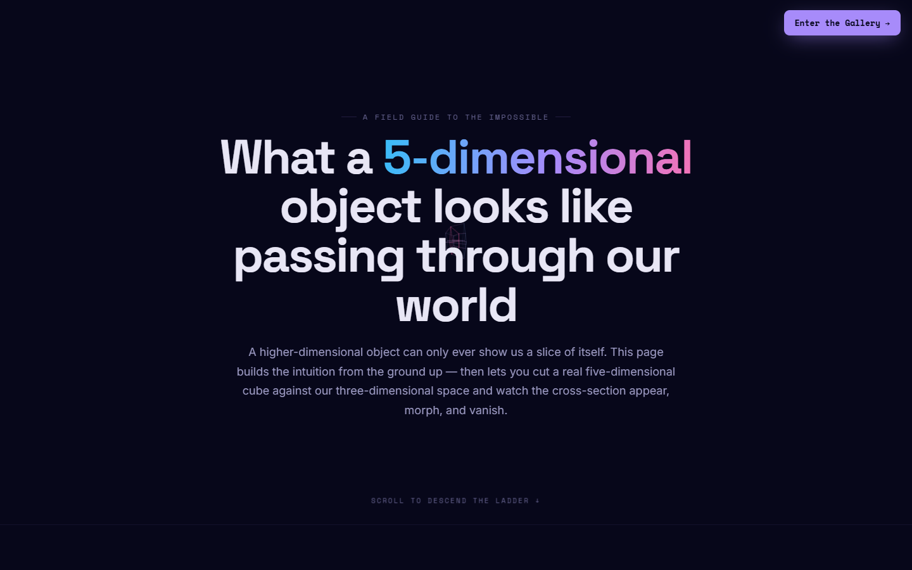
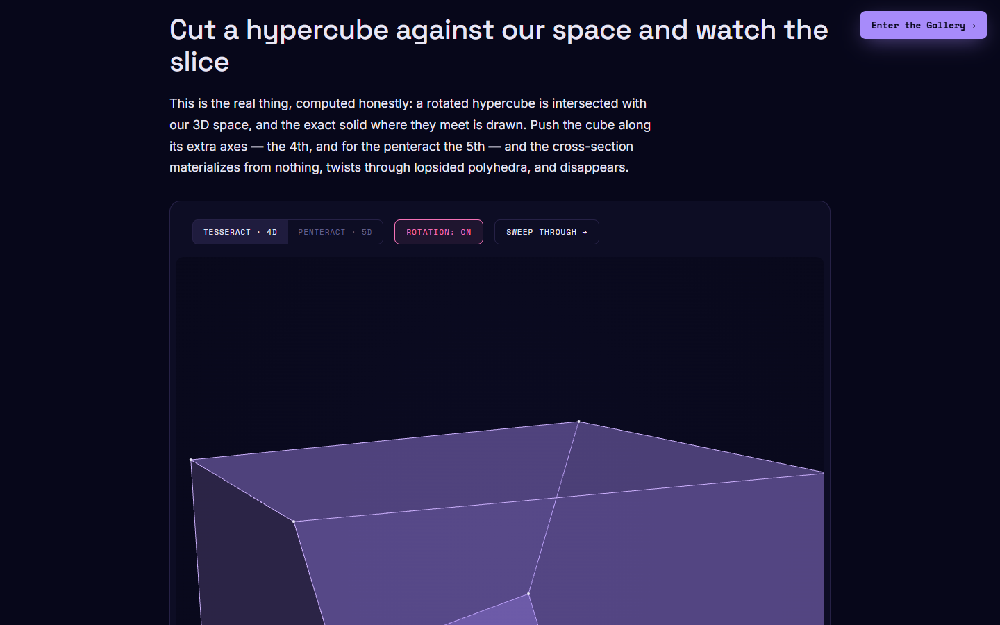
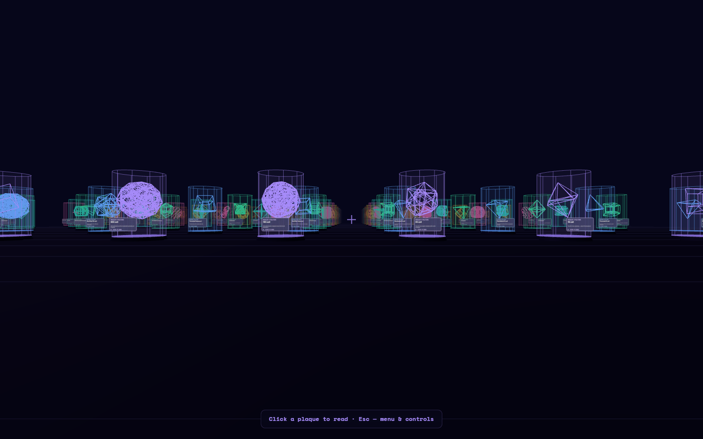

# Hyperspace

A single-page field guide to what a hyperdimensional object would look like passing through our world: interactive hypercube slices and projections, then a walkable 3D gallery of 159 higher-dimensional exhibits.

   



Try it: [mindattic.com/hyperspace](https://mindattic.com/hyperspace/)

## Why

- Build real intuition for higher dimensions by climbing down before climbing up: a flat creature watching a sphere pass through its plane, then us watching a 4D and 5D cube pass through ours.
- See the actual cross-section, computed rather than faked: a rotated hypercube is intersected with 3D space and the exact solid is drawn.
- Watch a penteract's 32 vertices and 80 edges crowd into our space, and toggle its ten independent planes of rotation.
- Walk through 159 higher-dimensional objects in a 3D gallery, each with a plaque to read.
- Open one file in any browser: no build, no install, no account.
- Reuse the same 159 shapes anywhere: they live in a standard shape library in [MindAttic.Components](https://github.com/mindattic/MindAttic.Components/tree/main/web/components/Hyperspace), the shared package in the sibling MindAttic.Components repo, which the Cyberspace backdrop's Hyperspace Reader also draws from.

## Features

- Hero animation and a "ladder" that steps from 2D to Hyperdimensional.
- Slice explorer: choose a tesseract (4D) or penteract (5D), turn rotation on or off, sweep the cube through our space, and drag sliders for the offset along the 4th and 5th axes. A readout shows the vertex and face count of the current cross-section and whether the object is present at all.
- Projection explorer: cube, tesseract or penteract wireframes cast into 3D, with chips for each plane of rotation.
- What you would actually witness: six short accounts (it blinks in from nowhere, morphs two ways at once, passes through itself, knots fall open, there is no inside, it never settles).
- The Hyperspace Gallery: a hall of 159 exhibits, ten to a row, from the 5-cell, tesseract, 24-cell, 120-cell and 600-cell through the ten regular star polychora, every Wythoff truncation of the 5-cell, tesseract and 24-cell, the Gosset polytopes of E₆, E₇ and E₈, prisms, duoprisms, curved manifolds, knotted spheres, honeycombs, quasicrystals and sphere packings up to sixteen dimensions. Each exhibit has a plaque with notes and references.
- Desktop controls with pointer lock, touch controls with two virtual sticks, a pause menu, and a boot progress bar while the gallery loads.





## Quick start

Open the live page, or run it locally from a clone of the [MindAttic.Web](https://github.com/mindattic/MindAttic.Web) repo, where this page lives in the `Hyperspace` folder. Any static server works; this one serves the repo root so the local fallback below resolves:

```bash
git clone https://github.com/mindattic/MindAttic.Web.git
cd MindAttic.Web
python -m http.server 8000
```

Then open `http://localhost:8000/Hyperspace/index.htm`. You should see the landing screen above; scroll down for the explorers, or click Enter the Gallery.

Opening `index.htm` straight from disk also works. The shapes load from the CDN; if that file cannot be fetched (offline, or the pinned tag is not published yet), the page loads them from `../../MindAttic.Components/web/components/Hyperspace/hyperspace.js`, which a MindAttic.Components checkout next to your MindAttic.Web checkout provides.

Gallery controls:

| Input | Action |
| --- | --- |
| W, A, S, D | Move |
| Shift | Sprint |
| Mouse | Look |
| Click | Read a plaque |
| Esc | Menu |
| Touch | Left stick moves, right stick looks |

## How it works

```text
index.htm  (the only file in this folder: HTML, CSS and JavaScript)
  |-- Field guide: hero canvas, slice explorer, projection explorer, witness notes
  |-- Gallery: Three.js scene, pointer-lock controls (inlined), touch sticks
  |-- hyperspace.js from MindAttic.Components@V<n>/web on jsDelivr (fallback: ../../MindAttic.Components/web/...)
  |     `-- window.Hyperspace: the 159 exhibits as data (id, geometry generator, rotation planes,
  |         plaque facts, article, references) plus pure nD rotation and projection
  `-- three.min.js 0.160.0 from jsDelivr; Google Fonts (Space Grotesk, Space Mono, Inter)
```

The page keeps the engine: the explorers' cross-section maths, the Three.js hall, the controls and the
article modal. The shapes are the [Hyperspace component](https://github.com/mindattic/MindAttic.Components/blob/main/web/components/Hyperspace/Hyperspace.md)
of MindAttic.Components. The gallery takes each exhibit from `Hyperspace.shapes` (in order, 10 per row), gets
its wireframe from `Hyperspace.geometry(id)`, its cage-fitting scale from `Hyperspace.extent(id)` and each
frame's pose from `Hyperspace.pose(id, t)`; the explorers take their n-cubes from `Hyperspace.gen.nCube`
and project with `Hyperspace.projectDown`. To change a shape, its facts or its article, edit
`hyperspace.js` in MindAttic.Components and run the linked deploy, which tags the release and repins it here.

## Deployment

The page is published at [mindattic.com/hyperspace](https://mindattic.com/hyperspace/). `index.htm` is the whole site; there is no build step. It pins the shape library to the release tag the linked deploy sets.

Hyperspace is a member of MindAttic.Deploy's permanently linked group `mindattic-web` (the MindAttic.Components package, plus ryandebraal.com, mindatticcares.com, Hyperspace and mindattic.com in the MindAttic.Web repo). Deploy it with:

```powershell
cd D:\Projects\MindAttic\MindAttic.Deploy
npm run deploy -- --site hyperspace
```

That deploys every site in the group: it pins the next MindAttic.Components tag in every site page, runs each site's `build-sites.ps1 -Tag` hook, stamps the pages, commits `Pin MindAttic.Components V<n>` in MindAttic.Web, tags MindAttic.Components, pushes both, checks every asset is live on jsDelivr at that tag, then FTPS-uploads ryandebraal.com, mindatticcares.com, this page (`index.htm` to `/mindattic.com/hyperspace/`) and mindattic.com. `--dry-run` previews; `--no-link` deploys this page alone.

## Documentation

- [AGENTS.md](AGENTS.md): instructions for AI agents working in this folder
- [Hyperspace component](https://github.com/mindattic/MindAttic.Components/blob/main/web/components/Hyperspace/Hyperspace.md): the shape library's schema and API, and the Hyperspace Reader
- Tests: `MindAttic.Components/web/tests/package/specs/components/hyperspace.spec.mjs` (sibling MindAttic.Components repo; `npm run test:local` in `web/tests/package`) opens this page from disk and checks that the explorers draw and the gallery boots, from the pinned CDN file and from the local fallback

## License

This folder has no LICENSE file. All rights reserved.

Part of [MindAttic](https://mindattic.com) — see more projects at [github.com/mindattic](https://github.com/mindattic). Lives in [MindAttic.Web](https://github.com/mindattic/MindAttic.Web) with [mindattic.com](https://github.com/mindattic/MindAttic.Web/tree/main/mindattic.com), [ryandebraal.com](https://github.com/mindattic/MindAttic.Web/tree/main/ryandebraal.com) and [mindatticcares.com](https://github.com/mindattic/MindAttic.Web/tree/main/mindatticcares.com); its shapes come from [MindAttic.Components](https://github.com/mindattic/MindAttic.Components).
