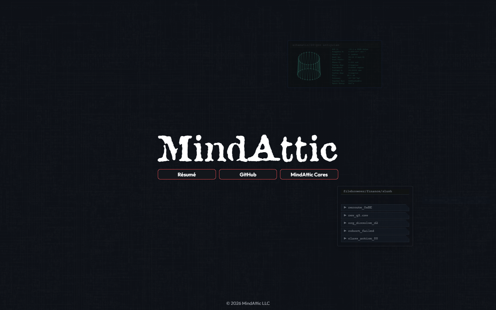

# MindAttic.Web

The MindAttic web family's four static sites: hand-made single pages that load their shared fonts, logos, effects and widgets from [MindAttic.Components](https://github.com/mindattic/MindAttic.Components) on jsDelivr, deployed together by one tag.

[](mindattic.com/index.htm) [](https://github.com/mindattic/MindAttic.Components/tree/main/web/components) [](#how-the-cdn-serves-the-shared-package) [](https://github.com/mindattic/MindAttic.Components/tree/main/web/tests/package) [](https://mindattic.com)



Try it: [mindattic.com](https://mindattic.com), [ryandebraal.com](https://ryandebraal.com), [mindatticcares.com](https://mindatticcares.com/), [mindattic.com/hyperspace](https://mindattic.com/hyperspace/)

## Why

- One change to a font, logo or effect reaches every site that uses it, with one release tag.
- Every page stays a single hand-authored HTML file with no build step; heavy assets are cached once on jsDelivr and shared.
- A published tag is immutable, so what a site loads today is exactly what it loads tomorrow.
- A deploy cannot ship a page that points at an asset the CDN does not serve: it checks every file, byte for byte, before any upload.
- One test run, in MindAttic.Components, covers the package and every site that loads it.

## Features

| Member | What it is | Live |
|---|---|---|
| [mindattic.com](mindattic.com/README.md) | Ryan DeBraal's front door: the MindAttic wordmark, three links and a tap-to-play Cyberspace backdrop | [mindattic.com](https://mindattic.com) |
| [ryandebraal.com](ryandebraal.com/README.md) | A resume that is its own work sample: 16 animated themes, 3 profiles, Markdown, HTML and PDF export | [ryandebraal.com](https://ryandebraal.com) |
| [mindatticcares.com](mindatticcares.com/README.md) | MindAttic Cares, the charity arm: open fundraising-event playbooks | [mindatticcares.com](https://mindatticcares.com/) |
| [Hyperspace](Hyperspace/README.md) | A field guide to five-dimensional objects: hypercube explorers and a 3D gallery of 159 exhibits | [mindattic.com/hyperspace](https://mindattic.com/hyperspace/) |

The shared package (the Cyberspace engine, SacredGeometry, the Hyperspace shape library and Reader, the
Outfit and Attic fonts, UI widgets, the ryandebraal.com themes and each site's logos and art) is the `web/`
folder of [MindAttic.Components](https://github.com/mindattic/MindAttic.Components). It used to live here as
`MindAttic.Web.Shared`.

## Quick start

Prerequisites: Git, PowerShell, Node.js and Google Chrome (for the tests). MindAttic.Components is cloned next to this repo.

```powershell
git clone https://github.com/mindattic/MindAttic.Web.git
git clone https://github.com/mindattic/MindAttic.Components.git
start MindAttic.Web\mindattic.com\index.htm          # any site opens straight from disk
cd MindAttic.Components\web\tests\package
npm ci
npm run test:local                     # package + all sites, CDN answered from the working trees
```

You should see the page with its backdrop and fonts, and the test run end with every test passed.

### Record or screenshot a site

`capture.ps1` opens a site in [MindAttic Browser](https://github.com/mindattic/MindAttic.Browser), served from this folder at `https://<site>.local/`:

```powershell
.\capture.ps1 ryandebraal.com -capture video          # film from open to close
.\capture.ps1 Hyperspace -capture screen 5             # a PNG every 5 seconds
```

Output goes to `R:\MindAttic\Capture\<site>\<site>_<timestamp>.<ext>` (for example `mindattic.com\mindattic.com_2026-10-11T18.05.00.000.mkv`). Add a duration to cap a run (`-capture video 8h`); disk, memory and encoder limits stop long runs automatically. Page script can also call `window.mindattic.capture.raise('name')` to mark moments.

## Project layout

```text
MindAttic.Web/
  README.md  AGENTS.md  CLAUDE.md  .gitignore  capture.ps1
  mindattic.com/                           index.htm, idiotproof/ legal pages and dataset, docs/
  ryandebraal.com/                         index.htm, docs/
  mindatticcares.com/                      index.htm, docs/
  Hyperspace/                              index.htm, docs/
```

Each member keeps its own README, docs and tools. The shared package is a sibling checkout,
`../MindAttic.Components`: its `web/build/build-sites.mjs` finds the pages at
`../../MindAttic.Web/<site>/index.htm`, and the Hyperspace page falls back to
`../../MindAttic.Components/web/components/Hyperspace/hyperspace.js` when opened from disk. Other repos
(MindAttic.Psst, Tutor, MindAttic.Deploy) sit next to it at `../<Repo>`.

## How the CDN serves the shared package

jsDelivr serves any file of the public MindAttic.Components repo at a tag. The sites load only its `web/` folder:

```text
https://cdn.jsdelivr.net/gh/mindattic/MindAttic.Components@V<n>/web/<path>
```

- Tags are whole numbers (`V1`, `V2`, ...), never SemVer, and never moved once published.
- Every site pins the same tag. The linked deploy writes it; nobody edits pins by hand.
- Fonts, logos, theme art, the Cyberspace engine and the Hyperspace library load from that URL. Smaller
  components are spliced into each page between `MINDATTIC.COMPONENTS:<name>` marker comments by
  `MindAttic.Components/web/build/build-sites.mjs`, configured in its `web/sites.json`.
- `MindAttic.Components/web/assets-manifest.json` lists every asset with its size and SHA-256; the deploy
  and the tests check the CDN against it.

Details: [PIPELINES](https://github.com/mindattic/MindAttic.Components/blob/main/docs/web/PIPELINES.md) and
[ASSETS](https://github.com/mindattic/MindAttic.Components/blob/main/docs/web/ASSETS.md).

## Deployment

[MindAttic.Deploy](https://github.com/mindattic/MindAttic.Deploy) owns deployment. Its linked group
`mindattic-web` is MindAttic.Components plus the four sites here: deploying any site deploys all of them.

```powershell
cd ..\MindAttic.Deploy
npm run deploy -- --uiux --dry-run     # preview: changes nothing
npm run deploy -- --uiux               # or: --site mindattic.com (any member deploys the group)
```

A linked deploy:

1. Preflight: both repos are clean, on `main` and not behind origin, and the asset manifest is current.
2. Computes the next MindAttic.Components tag.
3. Runs each site's preDeploy hook, `build-sites.ps1 -Site <site> -Tag V<n>`, which splices the
   components and pins the page to that tag, then stamps each page's Last Updated line.
4. Commits those changes here as "Pin MindAttic.Components V<n>".
5. Tags the MindAttic.Components commit.
6. Pushes both repos and the tag.
7. CDN gate: every asset the sites use must be live at that tag, byte-exact.
8. Uploads by FTPS in order: ryandebraal.com, mindatticcares.com, Hyperspace, mindattic.com.

If the package's `HEAD` already carries the latest tag and the pins match it, that tag is reused.
`--no-link` deploys one site alone.

## Testing

The Playwright suite in [MindAttic.Components/web/tests/package](https://github.com/mindattic/MindAttic.Components/tree/main/web/tests/package)
covers the package and these sites: assets complete and well-formed, every page loads with no failed
request, pins one tag, stays inside its allowed hosts and keeps its layout; the Hyperspace library, the
Hyperspace Reader and the Hyperspace page. `npm run test:local` needs no network; `npm run test:live`
checks the real sites and the real CDN. Each member with Codex docs also runs `tools\codex.ps1 doctor`.

## Documentation

- [MindAttic.Components web docs](https://github.com/mindattic/MindAttic.Components/tree/main/docs/web): BIBLE, user stories, assets, pipelines
- [mindattic.com](mindattic.com/README.md): [BIBLE](mindattic.com/docs/BIBLE.md), [user stories](mindattic.com/docs/USER_STORIES.md)
- [ryandebraal.com](ryandebraal.com/README.md): [BIBLE](ryandebraal.com/docs/BIBLE.md), [user stories](ryandebraal.com/docs/USER_STORIES.md)
- [mindatticcares.com](mindatticcares.com/README.md): [BIBLE](mindatticcares.com/docs/BIBLE.md), [user stories](mindatticcares.com/docs/USER_STORIES.md)
- [Hyperspace](Hyperspace/README.md)
- Agent instructions: [AGENTS.md](AGENTS.md)

## License

This repo has no LICENSE file. All rights reserved. The pages load the Outfit typeface (from Google Fonts) out of MindAttic.Components.

Part of [MindAttic](https://mindattic.com) — see more projects at [github.com/mindattic](https://github.com/mindattic). Related: [MindAttic.Components](https://github.com/mindattic/MindAttic.Components), [MindAttic.Deploy](https://github.com/mindattic/MindAttic.Deploy), [MindAttic.Psst](https://github.com/mindattic/MindAttic.Psst).
